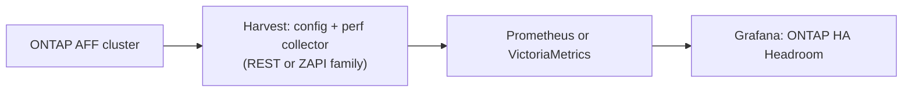

# Design: how takeover headroom is scored

## The question being answered

Stock **ONTAP: Headroom** answers "is this node already past its latency knee?" That is
per-node, present-tense health. It does not answer the question a storage admin actually
has before an upgrade, a maintenance window, or a 3 a.m. page:

> If one node goes down, can its partner carry both workloads without hurting?

This dashboard estimates the survivor's post-takeover load and compares it to a safe
ceiling. Active IQ Unified Manager's **Node Failover Planning** page is NetApp's
productized version of the same idea. The CPU logic here follows AIQUM's; the network side
is added because a saturated LAG is just as service-affecting as a saturated CPU.

Two dashboards share this model. **ONTAP: HA Headroom** is the go/no-go light.
**ONTAP: HA Headroom Debug** is the same score with every chart open. Both are generated
from `grafana/generate_ha_headroom.py`, so a query change lands in both.



## The HA pair is the unit of truth

**A takeover is always within an HA pair.** When a node fails, ONTAP gives its aggregates,
LIFs and workloads to its partner — never to a third node, and never spread across the
cluster. Two consequences follow, and both matter:

1. **Scoring must be pair-scoped.** Summing CPU across a whole cluster is correct only when
   the cluster *is* one HA pair. On a 4-node cluster it produces a meaningless number: a
   quiet pair and a saturated pair get averaged into the same score.
2. **The cluster roll-up is the worst pair, not a cluster-wide sum.** An "N+1, can the
   remaining N−1 nodes absorb it?" score would be misleading, because that redistribution
   never happens. The cluster is as safe as its least safe pair.

Harvest makes this possible: the config collector exports `node_labels{ha_partner="..."}`
(Harvest 24.05+). Perf metrics come from a different template and lack that label, so each
one is joined to `node_labels` first, then matched against its partner. The mechanics are
in [METRICS.md](METRICS.md#ha-pair-scoping).

Each pair produces **two series**, one per direction, labelled `survivor` and `victim`:
"if `victim` fails, `survivor` carries this." The two are **always numerically identical**,
not merely usually: each direction evaluates to `val(A) + val(B)`, and every downstream stage
— the percentile, the risk index, the max across resources — is a function of that single
number. Nothing in the model reads the direction.

They are not collapsed into one series per pair because that would mean choosing a canonical
direction, which requires comparing `node` against `ha_partner`, and PromQL has no
label-comparison operator. (The same wall makes the model-mismatch check cluster-scoped.)
`label_join` would yield `"A,B"` and `"B,A"` — still two keys.

So the pair keys stay, and the **panels are framed per surviving node instead**: one tile
per node, answering "if this node's partner failed, what would it carry?" Look up the node
you intend to keep running. The direction would become meaningful only with the
capacity-weighted model in [ROADMAP.md](ROADMAP.md#pair-scoped-model-mismatch-detection),
which needs a per-model capacity weight that Harvest does not export.

## CPU: the primary signal

### Preferred model — performance capacity used

These are the counters AIQUM uses, and Harvest already collects them from
`resource_headroom_cpu`:

| Metric | Meaning |
| --- | --- |
| `headroom_cpu_current_utilization` | Average CPU used, 0–100 |
| `headroom_cpu_optimal_point_utilization` | The latency knee — past it, latency rises disproportionately |
| `headroom_cpu_optimal_point_confidence_factor` | 0 unknown, 1 seed value, 2 medium, 3 high |

Per node:

$$\text{PCU} = 100 \times \frac{\text{current\_utilization}}{\text{optimal\_point\_utilization}}$$

Per HA pair, the takeover estimate is the sum of both nodes' PCU. **200% means the survivor
would sit exactly at its optimal point** — the same line AIQUM's "Node HA pair
over-utilized" policy uses.

| Colour | Combined PCU | Interpretation |
| --- | --- | --- |
| Green | < 160% | Survivor keeps roughly 20% of its performance capacity in reserve |
| Yellow | 160–200% | Survivor at or near the latency knee |
| Red | > 200% | Survivor past its optimal point — latency will suffer |

160% is deliberately conservative for an operations audience: the bar for "go ahead and
take a node down" should be *clearly* safe, not marginally safe. AIQUM's own custom-policy
example uses 175%, which is a reasonable alternative.

### Fallback model — CPU busy, and why it matters more than it looks

PCU is only meaningful when ONTAP has *measured* the optimal point. At confidence **1**,
ONTAP is using a **seed value**, not a measured curve — documented expected behaviour on
lightly loaded or recently rebooted nodes, not a bug. Stock Harvest gates its own Available
Ops panel on confidence > 1 for the same reason.

**Expect confidence 1 to be common**, especially on a healthy, comfortably sized 2-node
cluster. So the fallback is not a footnote; it may well be the model that actually drives
your traffic light day to day.

The fallback is the sum of `node_cpu_busy` across the pair. `node_cpu_busy` tracks the
**hottest CPU domain** (or remaining idle, whichever binds first), which makes it the better
"how close to the wall" number than `node_avg_processor_busy` — an average across cores can
look comfortable while one domain is saturated.

| Colour | Sum of `node_cpu_busy` | Rationale |
| --- | --- | --- |
| Green | < 70% | Room for HA overhead and bursts |
| Yellow | 70–85% | Latency-sensitive; do not take a node at peak |
| Red | > 85% | A domain or remaining idle is likely exhausted after takeover |

A well-sized 2-node design keeps **each** node under roughly 40–50% so the pair sum stays
green. 80% on a single node is not "fine" — it is a takeover problem.

The dashboard switches models automatically and shows the confidence factor so you can see
which one is in play. Only one of the two headline CPU tiles drives the score at any moment;
the other is reference only, and its colour can disagree with the traffic light. A loaded
cluster is the case where this bites: it has enough load for ONTAP to measure the knee, so
confidence reaches 2 or 3 and PCU takes over — leaving a red combined-CPU-busy tile that is
no longer scoring anything.

Confidence itself is deliberately **not** colour-coded as health. It describes the quality of
ONTAP's measurement, not the safety of a takeover, and a seeded knee is the expected state on
a comfortably sized cluster. The tile is blue with `0 unknown` / `1 seed` / `2 medium` /
`3 high` mappings, so the quietest cluster in an estate no longer looks like the only broken
one. Its mapping text avoids naming a model because the gate is `$ConfMin`: at `ConfMin=1`,
confidence 1 does trust PCU.

### One awkward property of the fallback

`node_cpu_busy` comes from `system:node`, which ONTAP treats as an **aggregated** counter
table. When any node in the cluster is unreachable, ONTAP marks *every* row incomplete —
including the healthy nodes' — and consumers that respect that flag drop the whole object.
Harvest 25.11 added `allow_partial_aggregation: true` to work around it.

`headroom_cpu` is not an aggregated table and does not have this problem.

So the model most likely to be driving your traffic light day to day is also the one that
degrades worst at the moment a node actually fails. This does not undermine the score in
normal operation — it is a caveat about what you will see *during* an outage, not before one.
Run Harvest 25.11 or newer if you can. Details and the exact failure modes are in
[METRICS.md](METRICS.md#behaviour-during-a-takeover).

## Network: Ethernet data ports

NAS LIFs fail over onto the partner's ports, so the survivor's ports carry both nodes'
traffic. The estimate is the sum of the same NIC or ifgrp name on both nodes.

`nic_util_percent` is already `max(rx, tx)`, and for ifgrps the same is derived from
`nic_ifgrp_rx_perc` and `nic_ifgrp_tx_perc`. Taking the max rather than the sum of both
directions avoids double-counting a full-duplex link; whichever direction binds first is
the one that matters.

| Colour | Estimated survivor port utilization | Interpretation |
| --- | --- | --- |
| Green | < 70% | Headroom for bursts, TCP behaviour and imperfect LAG hashing |
| Yellow | 70–85% | Queueing, pause frames, latency |
| Red | > 85% | Loss or saturation — treat as a service interruption risk |

Industry practice alerts on Ethernet at 70–80% even *before* modelling failover, so 70% as
the green ceiling *after* summing both nodes is intentionally conservative.

**iSCSI and NVMe-TCP are scored through these same Ethernet ports.** That is not a design
choice — Harvest exposes no per-port utilization counter for either protocol. The Ethernet
ports those protocols run over are the best available proxy.

### Excluding cluster-interconnect ports by ipspace, not by name

Only data ports should influence the score. The first version of this dashboard excluded
cluster ports with a name regex defaulting to `e0a|e0b|e0M`. **That is wrong on every
platform this customer runs**, per NetApp's platform cluster-port reference:

| Platform | Default cluster ports |
| --- | --- |
| AFF A30, A50, C30, C60 | `e4a`, `e4b` |
| AFF A70, A90, A1K, C80 | `e1a`, `e7a` |
| AFF A400 | `e3a`, `e3b` |
| Older FAS/AFF (A220, A300, FAS8200) | `e0a`, `e0b` |

On an A70 or A90, `e0a`/`e0b` are usually NS224 shelf ports. A regex of `e0a|e0b|e0M` would
therefore exclude the wrong ports *and* leave the real 100GbE cluster interconnect in the
score — where its traffic could turn the light red for no reason.

The fix is to filter on **ipspace** via `net_port_status`, which is a first-class ONTAP
concept present in both the REST and ZAPI Harvest templates and stable across platforms.
`ExcludePorts` survives as an extra name-based safety net, defaulting to `e0M`. The
dropdown also carries per-model presets for A70/A90, A30, and A220/older FAS; see
[grafana/README.md](../grafana/README.md#customizing-port-exclusions) for how to customize
it without editing files.

## From utilization to one traffic light

CPU and network have different native scales (160/200 vs 70/85), so each is mapped onto a
shared **risk index** where **1.0 is exactly the yellow line and 2.0 exactly the red line**:

$$\text{index}(v) = \min\left(\frac{v}{\text{yellow}},\ 1\right) + \max\left(\frac{v - \text{yellow}}{\text{red} - \text{yellow}},\ 0\right)$$

The index keeps climbing past 2.0, so you can distinguish "just over the line" from "far
over it". The overall score is the maximum index across resources, and Grafana colours it
with a single threshold pair. The `resource` label is preserved on a detail panel so you can
see whether CPU or network is driving the number.

## Time window

All traffic-light inputs are the **95th percentile over `$Window`** (default 30 minutes), so
a momentary spike cannot flip the light, but a sustained problem will. This matches AIQUM's
"HA pair over-utilized" policy, which requires roughly 30 minutes of samples before firing.

The 7-day state timeline uses the same index to answer the follow-on question: *when* is it
safe? Green bands are good maintenance windows.

## Tuning thresholds

Thresholds are Grafana variables, hidden by default to keep the header uncluttered. Override
them per session with a URL parameter:

```
/d/cdot-ha-headroom/?var-PcuYellow=175&var-PortYellow=75
```

| Variable | Default | Controls |
| --- | --- | --- |
| `PcuYellow` / `PcuRed` | 160 / 200 | Combined PCU |
| `BusyYellow` / `BusyRed` | 70 / 85 | Combined `node_cpu_busy` |
| `PortYellow` / `PortRed` | 70 / 85 | Estimated survivor port utilization |
| `ConfMin` | 2 | Minimum headroom confidence before PCU is trusted |
| `Window` | 30m | Percentile window |
| `ExcludePorts` | `e0M` | Extra port-name exclusions on top of the ipspace filter. Presets for A70/A90, A30, A220. Custom values can be typed directly into the dropdown. |

To make a change permanent, edit the defaults in `generate_ha_headroom.py` and regenerate.

## Caveats — state these when you hand the dashboard over

- **Summing CPU is a proxy, not a simulation.** Takeover adds real overhead the counters do
  not show: giveback work, background jobs, NVRAM and WAFL activity. A pair at 45% + 45% is
  not guaranteed to be a comfortable 90%.
- **The survivor's own optimal point shifts after takeover.** More domains become active, so
  the knee itself moves. The model treats it as fixed.
- **Green does not mean "go" on its own.** If latency is already high, do not plan a takeover
  regardless of the score. The context row exists for exactly this check.
- **Summing normalized percentages assumes equal node capacity.** True within a real HA pair,
  which must be same-model. The dashboard counts distinct models per cluster and flags
  anything other than 1.
- **Unmodelled resources.** Harvest has no NVRAM, HA-interconnect, or memory-pressure
  counter. On A70/A90 the cluster interconnect and HA traffic share the same physical 100GbE
  ports, so HA interconnect load is genuinely invisible here.
- **The scored panels blank out during an actual takeover.** The pair sum needs a series from
  both nodes, so while one is down there is nothing to sum. On Harvest older than 25.11,
  `node_cpu_busy` may also blank for the *surviving* node because of ONTAP's partial-aggregation
  flag. This dashboard answers "what if a node goes down", not "what is happening now that one
  has" — but do not expect it to be your view during an incident.
- **Not AIQUM.** This does not reproduce AIQUM's estimated ms/op after takeover; that model
  is proprietary.
- **Aggregate and disk headroom are omitted on purpose.** The scope is all-flash, where they
  are not the binding constraint.

## Validating against ONTAP

Pick one busy interval and one quiet interval, then compare:

- Combined PCU against `statistics show -object resource_headroom_cpu` — read current and
  optimal utilization per node, compute PCU for each, and add them.
- Port sums against `statistics show` or System Manager for the same ifgrp or NIC names.
- Confirm the ports listed in the **Ethernet ports in scope** panel are the ones you expect,
  and that no cluster port appears there.

The offline tests in `grafana/test_promql.py` already prove the pair arithmetic, roll-up,
confidence gate and port filtering behave correctly against synthetic series. What they
cannot check is whether *your* cluster's labels match — that is what the comparison above is
for.
