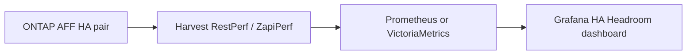

# HA takeover headroom dashboard (Harvest + Grafana)

A Grafana HA-headroom dashboard is viable with existing NetApp Harvest metrics. The stock ONTAP: Headroom dashboard answers “is this node already past its latency knee?” — not “can the survivor absorb both nodes after takeover.” The new dashboard should combine both nodes’ CPU performance capacity and data-path port utilization, with green/yellow/red mapped to NetApp’s failover-planning thresholds.

Scope: NAS and SAN (Ethernet/ifgrp and FC / iSCSI / NVMe).

## Verdict

**Yes, this is viable**, and you should **not need new Harvest collectors** if RestPerf/ZapiPerf already include `resource_headroom_cpu`, `system:node`, `nic_common`, and (for SAN) FCP/iSCSI/NVMe port objects.

What Harvest does **not** ship is a **node-failover / N+1** dashboard. Stock **ONTAP: Headroom** (`grafana/dashboards/cmode/headroom.json`) is per-node current vs optimal point (CPU **and** aggregate). That is useful context, but it does not model “node A + node B on one controller.” Active IQ Unified Manager’s **Node Failover Planning** page is the productized version of this idea; Grafana can approximate the same **CPU** logic with PromQL. It will **not** reproduce AIUM’s estimated takeover latency (that model is proprietary).

**Assumption:** 2-node HA (not MetroCluster). After takeover, the survivor runs **both** nodes’ data services; NAS LIFs fail over onto the partner’s Ethernet/ifgrp; SAN hosts keep using (or fail over to) the survivor’s target ports.

---

## High-level approach

1. **Reuse Harvest** — confirm pollers collect the objects below (they are in default RestPerf/ZapiPerf templates). Import stock dashboards only as a **data check** (`ONTAP: Headroom`, `ONTAP: Node`, `ONTAP: Network`).
2. **Build a dedicated dashboard** (clone Headroom, then change the math). One cluster / HA pair selector. Overall status = **worst of** CPU headroom and each data-path you care about (Ethernet + FC/iSCSI/NVMe as applicable).
3. **Score takeover, not current node health.** For each resource: estimate **survivor utilization ≈ node1 + node2** (same-direction traffic for ports). Compare that to a **safe ceiling** (CPU: ONTAP optimal point / AIUM 200% pair PCU; ports: ~70–80% of remaining link/ifgrp capacity).
4. **Time windows.** Instantaneous spikes should not flip the traffic light. Use **95th percentile over 15–30 minutes** (or `avg_over_time` for planned maintenance windows) so the panel answers “is it safe to take a node now / would an unexpected failure hurt?”
5. **Do not use aggregate/disk headroom** for AFF (matches your scope). Optional: hide those panels from a cloned Headroom dashboard.

Caveats to state on the dashboard (small text / tooltip):

- Sum of CPU % is a **conservative proxy**; takeover adds HA overhead (giveback, background jobs, NVRAM/WAFL). A pair at 45%+45% is not guaranteed to be a happy 90%.
- Ethernet **ifgrp** modeling is better than summing every physical NIC (cluster interconnect and unused ports would inflate or confuse).
- SAN: hosts with **multipath** already send I/O to both nodes; after node loss, remaining paths on the survivor see **more** I/O, but it is not always a clean 1+1 of target-port % (depends on ALUA/path policy). Treat port sum as **upper bound**.
- ONTAP **optimal point** is only trustworthy when `headroom_cpu_optimal_point_confidence_factor` is **2 or 3**. At **1**, fall back to raw CPU % (see table).

---

## Follow-up work

- Confirm Harvest already scrapes `headroom_cpu_*`, `node_cpu_busy`, `nic_ifgrp_*` / `nic_util_percent`, `fcp_util_percent` for the AFF cluster.
- Define PromQL: per-node PCU, pair `PCU_takeover`, 15–30m 95th percentile, confidence-factor gate.
- Define PromQL: ifgrp and FCP survivor estimates; exclude cluster/mgmt ports.
- Build a dedicated HA Headroom Grafana dashboard (clone Headroom, drop aggregate panels, add pair traffic lights).

---

## Primary metric: CPU (use this for the main traffic light)

### Preferred: ONTAP resource headroom (same counters AIUM uses)

Harvest names (already on **ONTAP: Headroom**):

| Harvest metric | Meaning |
| --- | --- |
| `headroom_cpu_current_utilization` | Average CPU used (%) |
| `headroom_cpu_optimal_point_utilization` | Latency “knee” — beyond this, latency rises disproportionately |
| `headroom_cpu_optimal_point_confidence_factor` | 0 unknown, 1 low, 2 medium, 3 high |
| `headroom_cpu_current_ops` / `headroom_cpu_optimal_point_ops` | Optional: available ops = optimal − current (when confidence > 1) |

**Performance capacity used (per node)** — AIUM-style:

`PCU_node = 100 * current_utilization / optimal_point_utilization`

**HA pair (2-node takeover estimate):**

`PCU_takeover = PCU_node1 + PCU_node2`

This is the same idea as AIUM’s **“Node HA pair over-utilized”** policy: warning when **combined PCU exceeds 200%** for ~30 minutes (six 5-minute samples). Combined PCU of 200% means the survivor would be at **100% of its optimal-point capacity** (latency already in the bad part of the curve).

**Suggested traffic light (CPU / overall headroom):**

| Color | Combined PCU | Interpretation |
| --- | --- | --- |
| Green | **&lt; 160%** | Survivor still has ~20%+ performance capacity; unexpected or planned takeover should be fine |
| Yellow | **160–200%** | Survivor near or at the latency knee — **higher latency risk**, avoid planned failover at peak |
| Red | **&gt; 200%** | Survivor would exceed optimal capacity — **unacceptable latency / service-impact risk** |

Optional stricter yellow (closer to AIUM’s custom 175% example): yellow from **175%**. Start at 160% if the audience is operations (“don’t take a node unless it’s clearly safe”).

**When confidence is 1 (or optimal point looks like a seed, e.g. very low):** do not trust PCU. Use the fallback below.

### Fallback / second CPU row: raw CPU (always show)

Harvest:

- `node_cpu_busy` — **best single “how close to the wall” CPU number**: utilization of the **hottest CPU domain** (or remaining idle, whichever binds first). This is more relevant than average CPU for AFF under load.
- `node_avg_processor_busy` — average across cores; can look “fine” while one domain is saturated.
- `node_cpu_domain_busy` — drill-down (WAFL, RAID, Nwk_Exclusive, etc.) on the Node dashboard.

**Takeover estimate:** `cpu_busy_n1 + cpu_busy_n2` (and separately the same for `avg_processor_busy`).

**Suggested traffic light (raw CPU, if not using PCU):**

| Color | Sum of `node_cpu_busy` | Rationale |
| --- | --- | --- |
| Green | **&lt; 70%** | Room for HA overhead and spikes |
| Yellow | **70–85%** | Latency sensitivity; typical “don’t schedule takeover at peak” |
| Red | **&gt; 85–90%** | Domain or idle CPU likely exhausted after takeover |

Many 2-node AFF designs keep **each** node under ~40–50% `cpu_busy` in steady state so the sum stays green. Do **not** treat 80% **per node** as green; that is already a takeover problem.

---

## Network / SAN ports (second traffic light, worst-of with CPU)

Harvest already exposes these on **ONTAP: Network** / Node:

**Ethernet / NAS (LIF failover onto partner ifgrp):**

- `nic_util_percent` — max(rx%, tx%); **0–1 scale** (multiply by 100 in Grafana)
- `nic_rx_percent` / `nic_tx_percent`
- `nic_ifgrp_rx_perc` / `nic_ifgrp_tx_perc` and `nic_ifgrp_*_bytes` — **prefer ifgrp** for data LIFs
- Filter out **cluster** ports (typically `e0a`/`e0b` or `e0M` mgmt) so interconnect does not drive the score

**SAN:**

- `fcp_util_percent` (and related `fcp_*` throughput) for FC
- iSCSI/NVMe-TCP: same Ethernet ifgrps as NAS, or dedicated ports — use the **same ifgrp/port %** for those data ports
- NVMe/FC: FCP-side utilization where Harvest exposes it

**Takeover model (conservative):**

For each **failover domain** (e.g. “data ifgrp a0a on node1” paired with “data ifgrp a0a on node2” in the same broadcast domain):

`est_survivor_util = util_n1 + util_n2`

Use **max(rx, tx)** so a full-duplex link is not double-counted incorrectly; if one direction is the bottleneck, summing that direction across nodes is enough.

If the two nodes’ ifgrps are **equal speed**, this is “will the remaining LAG exceed 100%?”

**Suggested traffic light (ports):**

| Color | Estimated survivor port/ifgrp util | Interpretation |
| --- | --- | --- |
| Green | **&lt; 70%** | Headroom for bursts, TCP/FC credits, imperfect hash |
| Yellow | **70–85%** | Congestion / latency risk (queueing, pause, credit starvation) |
| Red | **&gt; 85%** (or **&gt; 100%**) | Packet loss / path saturation — treat as **service interruption** risk |

Industry practice often alerts Ethernet at ~70–80% even before failover; after summing both nodes, 70% green is intentionally conservative.

**SAN nuance:** if hosts already balance across both nodes, summing both nodes’ **target port %** can **overstate** post-failover load (some I/O already hits the survivor). Still useful as a **ceiling**. Complement with **protocol throughput** (`node_nfs_throughput`, iSCSI/FCP data rates) as a sanity chart, not the traffic light.

---

## Dashboard layout (what to build)

1. **Overall HA headroom** — single stat: worst of CPU (PCU if confidence ≥ 2, else raw `node_cpu_busy` sum) and max estimated port util. Green / yellow / red thresholds as above.
2. **CPU row** — PCU per node, combined PCU, current vs optimal utilization, confidence factor, optional available ops.
3. **CPU busy row** — `node_cpu_busy` per node + sum; sparkline of last 24h 95th percentile (answers “is tonight a good maintenance window?”).
4. **Ethernet/ifgrp row** — per-node ifgrp rx/tx %, estimated survivor %, exclude cluster ports.
5. **SAN row** — `fcp_util_percent` (and iSCSI/NVMe ports if used) with the same sum model.
6. **Context (not in the traffic light)** — node latency (`node_nfs_latency` / FCP LIF latency) so operators can see if the cluster is **already** hurting before talking about failover.

No new Harvest templates unless a metric is missing in your version (verify with `bin/harvest grafana metrics` and a PromQL `count({__name__=~"headroom_cpu.*"})`).

---

## What this is not

- Not a substitute for **AIUM Node Failover Planning** if you need estimated **ms/op after takeover**.
- Not a guarantee: WAFL memory, NVRAM, HA interconnect, and background jobs can still bite; disk was skipped on purpose for AFF.
- Stock **ONTAP: Headroom** remaining useful as “is **this** node already past the knee **today**?” — keep it; add this dashboard for **pair** risk.

---

## Implementation (in this repo)

Deliverables (no new Harvest collectors):

| File | Role |
| --- | --- |
| [grafana/dashboards/cmode/ha_headroom.json](grafana/dashboards/cmode/ha_headroom.json) | Importable Grafana dashboard **ONTAP: HA Headroom** (Harvest Headroom style, **no aggregate** panels, pair traffic lights) |
| [grafana/promql-ha-headroom.md](grafana/promql-ha-headroom.md) | Metric verification, PCU PromQL, port survivor PromQL, thresholds |
| [grafana/generate_ha_headroom.py](grafana/generate_ha_headroom.py) | Regenerates the dashboard JSON |
| [grafana/README.md](grafana/README.md) | Import and variable notes |

Import the JSON in Grafana, point it at the Harvest Prometheus/VictoriaMetrics datasource, and run the metric `count(...)` check in the PromQL notes against your live TSDB.

Work is Grafana JSON + PromQL against Harvest’s existing series (VictoriaMetrics is PromQL-compatible). Validate by picking a busy and a quiet window and checking that combined PCU and port sums match `statistics show` / ONTAP System Manager for those intervals.
